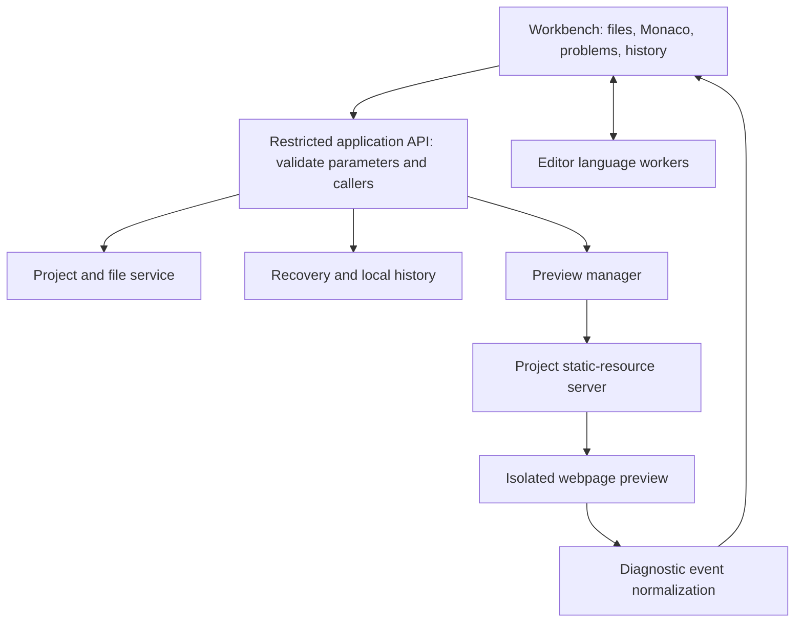

**NoobIDE: Product and Implementation Plan for a Beginner-Friendly Web Development IDE**

Prepared: 2026-10-14. Status: planning draft; implementation has not started.

Confirmed requirements: the first release targets HTML / CSS / JavaScript web development, will be built by a solo developer, and will officially support both Apple Silicon Mac and Windows from launch. The project is currently in the planning stage, with no existing implementation to preserve. macOS will use a native arm64 build; Windows is provisionally planned for x64, with Windows arm64 not yet confirmed. A Chinese-first product interface, prior TypeScript / React experience, and approximately 30 productive development hours per week remain adjustable assumptions. All schedule and performance figures are engineering estimates or targets that still need validation.

1. **Product positioning: help first-time web developers complete the entire development process independently.**

The first release should let users move smoothly through “create a webpage → edit → see the result → understand an error → fix it → recover changes → continue next time.” It should leave room to grow into professional IDE capabilities, including project search, code navigation, debugging, Git, a terminal, and framework projects.

Use IntelliJ's complete development workflow and VS Code's editing experience as references, while reducing the configuration work, difficulty understanding errors, file-management confusion, and cost of experimentation that beginners commonly face. The first release should compete on how successfully users complete this workflow. Matching the overall depth of IntelliJ or VS Code requires a long-term investment and should not be an acceptance criterion for a solo developer's first release.

The initial audience is people with no more than three months of web-development experience who mainly build personal homepages and simple interactive pages. The first phase covers ordinary static websites, projects with multiple resource files, browser JavaScript, and ES Modules using relative paths. React, Vue, Node.js backends, SSR, and complex build projects belong in later releases.

Product principles: users can take their files elsewhere; core features work offline; application state is clearly visible; actions are recoverable; and users choose when to reveal advanced features. Keep standard terminology and real filenames in the interface, with short explanations that help users gradually understand external tutorials.

The first release supports the following platforms, with equal expectations for core functionality and release acceptance:

| Platform | Initial architecture and delivery | Support boundaries |
| --- | --- | --- |
| Apple Silicon Mac | Native macOS arm64 application, distributed as a DMG | The core application and bundled components do not depend on Rosetta; validate on physical Apple Silicon hardware |
| Windows | Provisionally a Windows x64 installer | Validate in a native Windows environment; assess Windows arm64 separately |

Choose minimum operating-system versions in week 1, alongside the stable Electron version and test devices, and document them in the release notes. Include both the minimum supported versions and the current stable operating systems at release time in the test matrix. Intel Mac and Linux remain candidates for later evaluation. Electron provides native binaries for Apple Silicon and Windows, but the product's actual compatibility must still be verified through packaged builds and real-device testing. [Electron platform support](https://github.com/electron/electron#platform-support)

2. **First-use journey: complete a learning cycle with visible feedback in ten minutes.**

| Step | User action | Expected IDE feedback |
| --- | --- | --- |
| Create | Click “Create my first webpage” and enter a name and location | Create a normal local folder; the default template is immediately available in the preview |
| Understand the files | Open index.html, style.css, and script.js | Show brief descriptions: “Page structure / Visual styling / Interactive behavior” |
| Change the structure | Replace the template heading with the user's name | Refresh the webpage on the right after a successful automatic save, showing the latest state |
| Change the style | Edit a color or font size | Color hints and completion help with input, and the result is immediately visible |
| Add interaction | Change the text displayed after a button click | Let the user click the button in the preview to verify that the JavaScript works |
| Handle an error | Deliberately misspell a variable name | Show a problem card with the file, line number, explanation, suggested checks, and original error |
| Recover | Restore a file's previous saved version | Show the diff first; save the current version before restoring |
| Continue | Close the application and reopen the project | Restore file tabs and layout, and clearly show where the project is stored |

The walkthrough takes place inside a real project and can be skipped or revisited. Afterward, give the user a small task without step-by-step prompts to check whether they understand the workflow. Limit the first release to three templates: a personal introduction page, a product showcase page, and a button counter. Bundle all image and font resources locally.

3. **Interface: make the code and its result the visual focus.**

| Area | Default content | Interaction requirements |
| --- | --- | --- |
| Top | Project name, save status, preview toggle, help, and more tools | Pair text with icons for common actions; keep positions stable |
| Left | Collapsible project file tree | Show real filenames; do not replace the file structure with proprietary concepts |
| Center | Editor and a small number of file tabs | Start at approximately 16px font size, support zoom, and provide light and dark themes |
| Right | Live webpage preview | Desktop / mobile width switch, refresh, stop, and open in an external browser |
| Bottom | Problems and console | Notify users when errors occur; avoid repeatedly taking focus or interrupting typing |

On an ordinary laptop screen, allow the file panel to collapse and the divider between code and preview to be dragged. When space is limited, offer a “Code / Preview” switch instead of forcing three narrow columns. Mobile preview changes only the viewport width; it does not claim to emulate a real mobile operating system or touch behavior.

Provide “Automatic refresh” and “Manual refresh” modes. By default, refresh after a pause in typing and a successful file save. Briefly explain that reloading HTML / JS may clear forms and temporary page state. Full-page refresh is acceptable for the first release; replacing CSS without a reload can be added later.

Support keyboard access for all key actions. Completion menus, dialogs, the file tree, and the problems list should have a clear focus order. Pair colors with text or icons to communicate state. A save failure must be indicated by more than a color change.

Map shortcuts by platform through a shared command system: Ctrl+S / Ctrl+Z on Windows and Cmd+S / Cmd+Z on macOS, with the appropriate symbols in menus and hints. Adapt to the macOS system menu, window controls, and application reactivation after all windows are closed, as well as the Windows convention of exiting when the last window closes. Show “Reveal in Finder” or “Show in File Explorer” as appropriate. Place advanced tools under “More tools,” adding the terminal, debugger, and version control later. Do not automatically move controls based on an inferred skill level.

4. **MVP scope: deliver a static-webpage IDE that users can keep using.**

| Module | Required in the first release | Definition of done |
| --- | --- | --- |
| Projects | Create from templates, open normal folders, recent projects, reveal the location in the operating system | Paths containing Chinese characters and spaces work correctly |
| Files | File tree, create files / folders, rename, recoverable deletion | Failures explain the cause; existing files are never silently overwritten |
| Editing | Multiple tabs, syntax highlighting, indentation, comments, find and replace, undo and redo | Chinese input methods and common shortcuts work; switching files preserves editing state |
| Code assistance | Basic HTML / CSS / JS completion, hover information, formatting, and supported static diagnostics | Validate each language capability with real examples; do not equate highlighting with full language analysis |
| Saving | Automatic saving by default, manual saving, explicit status, handling conflicts with external changes | Preserve edits after a save failure; the preview must not claim to be updated |
| Running webpages | Serve static resources within the project, select an entry page, support relative resource paths and basic ES Modules | Webpages with multiple files and requests for local JSON work; no separate Node.js installation is required |
| Preview | Embedded preview, refresh / stop, viewport width, open in an external browser | The editor remains usable when page scripts fail or the page becomes unresponsive |
| Errors | Console logs, JS exceptions, resource-loading failures, navigation to the relevant code line | Attribute errors to the correct preview session and retain the original information |
| Beginner help | Three templates, a short walkthrough, explanations for 10–15 common problem types | Explanations suggest concrete checks and identify possible causes when uncertain |
| Recovery | Editing undo, recovery of unsaved content, local file history, diffs before restoration | Verified recovery paths exist for crashes, accidental deletion, and unintended edits |
| Distribution | macOS arm64 and Windows x64 installers, local logs, version information, manual upgrade instructions | Installation and use work on clean environments on both platforms without Node.js / Git |

The MVP excludes React / Vue, npm management, a terminal, a Git interface, an open extension marketplace, AI chat, cloud accounts, collaboration, one-click publishing, and a custom breakpoint debugger. Advanced users may open the preview's Chromium developer tools through an explicit entry point, but the first release will not recreate a complete debugging interface for them.

Cross-file JavaScript navigation and renaming depend on project indexing and language-service configuration. Only describe capabilities that have passed scenario-based validation. Workspace-wide text search and semantic renaming can be the first incremental release after the MVP.

5. **Technology approach: prefer Electron + React + TypeScript + Monaco.**

| Approach | Value for the current requirements | Cost and selection criteria |
| --- | --- | --- |
| Electron + Monaco | Allows an interface centered on editing and webpage preview; scope can be controlled feature by feature | Workspace management, saving and recovery, preview, and diagnostic integration must be implemented; currently the preferred option |
| Eclipse Theia | Provides an IDE platform on which to combine editing, extensions, and development tools | Requires learning the platform and its customization mechanisms; reassess if broad IDE capabilities become an immediate requirement |
| Code-OSS fork | Starts with a complete workbench | Major UI changes, building, and tracking upstream updates add maintenance work; suitable if much of the existing interaction model will be retained |

This recommendation is an engineering judgment based on a solo developer launching first with plain web projects. Monaco is an editor component and cannot directly host VS Code extensions. Theia is a platform for building custom desktop and cloud IDEs. [Monaco official documentation](https://github.com/microsoft/monaco-editor), [Theia documentation](https://theia-ide.org/docs/)

Distinguish the Code-OSS source from Microsoft's distributed VS Code product. Microsoft's official FAQ explicitly restricts other products' access to Visual Studio Marketplace. Extension acquisition and redistribution arrangements also require individual review; the first release does not assume access to that marketplace. [VS Code official FAQ](https://code.visualstudio.com/docs/supporting/faq)

The recommended stack follows. Pin compatible stable versions when development starts, and validate actual packaged applications on both platforms during the first 2–3 weeks, rather than testing only through a development server.

| Layer | Choice | Usage |
| --- | --- | --- |
| Desktop host | Electron | Windows, file dialogs, operating-system integration, and a separate preview context |
| Interface | React + TypeScript | A component-based workbench; simple module state is sufficient initially, without a complex state-management framework |
| Editing | Monaco Editor | File models, editing history, and basic language capabilities; load workers separately |
| Language capabilities | Prefer the HTML / CSS / JS services bundled with Monaco | Validate capabilities against real projects; do not build a custom language server for the first release |
| Files and configuration | Node file APIs and JSON settings | A service layer manages paths, atomic saves, and conflicts; ordinary source files remain unchanged |
| Preview | WebContentsView + a local static HTTP server | Separate the webpage from the IDE UI; the page has no file or process privileges |
| Error collection | Chromium / Electron events and a restricted diagnostic adapter | Convert logs, exceptions, and loading failures into a unified problem record |
| Local history | File snapshots + a JSON index | Apply storage limits, deduplication, and cleanup; no database is needed initially |
| Packaging | Choose one established tool, such as Electron Forge | Use a solution compatible with the frontend build; produce installers for both platforms in weeks 2–3 |
| Verification | Unit tests + Electron end-to-end tests + acceptance testing in clean environments on both platforms | Test saving, isolation, recovery, and real tasks separately on each platform; do not pursue coverage percentages alone |

The application bundles the Electron / Node components it needs, so learners do not need to configure Node.js. A user-managed Node environment for future framework projects is a separate feature that requires its own design. Packaging can use Forge's build and distribution capabilities; choose the specific template and dependency combination during technical validation. [Electron Forge documentation](https://www.electronforge.io/)

Use one codebase for both platforms, concentrating platform differences in adapters for windows, menus, shortcuts, filesystems, and distribution. Prefer pure JavaScript / TypeScript dependencies. Before introducing native modules or helper executables, verify their macOS arm64 and Windows x64 artifacts against the selected Electron ABI, rebuilding separately where necessary. Do not copy a development machine's node_modules or binaries directly to another platform.

Establish a macOS arm64 and Windows x64 build matrix in weeks 2–3, producing installers in local or CI environments running the corresponding operating system. Execute macOS release workflows on a Mac; cross-packaging on Windows does not count as macOS delivery validation. Forge's official guidance also recommends using platform-specific build environments to handle cross-platform differences. [Forge build lifecycle](https://www.electronforge.io/core-concepts/build-lifecycle)

Default to direct downloads for public distribution. The macOS workflow includes Developer ID signing, notarization, and stapling the notarization ticket, followed by first-launch validation using an actually downloaded DMG. Make the Apple Developer account and signing preparation release dependencies in week 1. The Windows workflow includes signing the installer and application, and validating initial installation and upgrades. Keep credentials confined to the release environment. Do not claim that signing necessarily removes every operating-system reputation warning. [macOS signing and notarization](https://www.electronforge.io/guides/code-signing/code-signing-macos), [Windows signing](https://www.electronforge.io/guides/code-signing/code-signing-windows)

6. **Architecture: maintain clear boundaries and manageable maintenance costs for a solo developer.**



Keep files, preview, diagnostics, and recovery in separate modules connected through interfaces, but start with a single repository. The first release does not need microservices, an account backend, a container cluster, or an extension SDK.

Suggested directory structure:

```text
src/
  main/          Electron windows, system integration, application lifecycle
  platform/      macOS / Windows menus, shortcuts, windows, and system adapters
  preload/       Restricted API available only to the trusted IDE interface
  renderer/      React workbench, file tree, Monaco, problems, and history UI
  workspace/     File reads and writes, watching, project entry points, settings
  preview/       Static server, preview view, refresh, stop, isolation
  diagnostics/   Unified error model, locations, explanation rules
  recovery/      Buffer recovery, history index, file snapshots
  shared/        Message types, settings schemas, shared data models
resources/
  templates/     Built-in webpage templates
  lessons/       Short walkthroughs and terminology explanations
tests/
  fixtures/      Multi-file webpages, Chinese paths, error and recovery examples
  integration/   File, preview, and diagnostic integration tests
  e2e/           Complete beginner tasks and desktop workflows
docs/            Product documentation, architecture decisions, release checks
```

Project source code remains in an ordinary folder. An optional `.noobide/project.json` stores only the entry page, preview preferences, and configuration version; it must not contain secrets or absolute machine-specific paths. Deleting this configuration still leaves an ordinary website. Store IDE caches, history, and unsaved recovery data in the application's data directory, with controls to reveal the location and clear the data. Logs should not record complete source code.

7. **Editing and saving: establish data reliability first.**

Give each real file a stable editor-model URI. Reuse its model when switching tabs and dispose of it correctly when closed. Handle Windows / macOS paths and file URIs consistently using standard path APIs. Do not concatenate fixed path separators or convert all paths to lowercase. Cover differences in filesystem case sensitivity, case-only renames, Unicode filenames, Windows reserved names, symbolic links, file locks, and file-watching events. Default to UTF-8, use LF for new files, and preserve the existing line-ending style in existing files. Clearly identify unsupported encodings or binary files to prevent destructive overwrites.

When moving a project between Mac and Windows, keep only relative paths in project configuration. Explicitly report names that cannot be represented on the target system and any case conflicts; do not silently rename files. Use platform APIs to locate application data directories instead of hardcoding user paths. If file access is denied, retain the edits and offer a way to choose a different location.

The save sequence is: edit → coalesce writes over a short interval → write a temporary file and replace the target → confirm success → update status → trigger preview. Preserve both error details and in-memory content when files are locked, directories are read-only, or disk space is insufficient. If an external file change conflicts with unsaved edits, offer a comparison and a choice instead of silently selecting either version.

Keep the undo stack, automatic saving, crash recovery, and local history independent. Automatic saving persists content to disk; undo serves the current editing session; recovery logs address abnormal termination; and history retrieves older versions. Do not combine these states into a generic “Backed up” status.

For the first release, maintain history per file, retaining necessary versions around coalesced save batches and before formatting, deletion, and restoration. Provide a visible storage limit and cleanup policy. Defer consistent versions across multiple files, whole-project snapshots, and Git to later releases. History is not a substitute for users' external backups.

8. **Preview: keep the user's webpage permissions separate from the IDE.**

Use a separate webpage context such as WebContentsView rather than inserting user HTML into the React interface's DOM. Disable Node integration in the preview, enable context isolation and sandboxing, and do not expose the IDE's file, IPC, or process APIs. Restrict new windows, external navigation, and sensitive permissions while retaining normal browser same-origin and network checks. Verify the exact settings against the current Electron documentation. [Electron security documentation](https://www.electronjs.org/docs/latest/tutorial/security), [WebContentsView documentation](https://www.electronjs.org/docs/latest/api/web-contents-view)

WebContentsView is not a React DOM node. Explicitly synchronize pane resizing, window resizing, DPI, view bounds, and keyboard focus, and verify how menus, dialogs, and overlays appear above it. Validate basic embedding and focus switching on both platforms in weeks 2–3; complete layout and view lifecycle handling in weeks 8–10. Explicitly clean up preview content when closing a project. Cover Mac Retina displays, different Windows scaling settings, moving between monitors, full screen, Chinese input methods, and sleep and wake.

The static server must listen only on a loopback address and serve only permitted files from the current project. Normalize paths and check the resolved real paths to block path traversal, symlinks escaping the project, and exposure of sensitive files. Support only the methods needed to read resources; do not expose arbitrary file-writing endpoints. Shut down the old server when switching projects, validate the Host header and session ownership, and test the boundaries against malicious webpages trying to read local resources. A random port is not access control.

Built-in templates can open directly in preview. When an external project is first opened, allow reading first and require an explicit “Start preview” action to run its webpage scripts. Future npm script support will need a stronger execution authorization design.

Track each preview instance as stopped, starting, running, refreshing, unresponsive, or failed. Stopping must destroy or recreate an unresponsive preview instance. Stopping network loading alone does not guarantee interruption of a JavaScript infinite loop. In weeks 2–3, test `while(true)` and heavy logging in packaged applications on both platforms. If either affects editor responsiveness, fix the isolation approach before proceeding.

Use separate preview sessions and browser storage for different projects, and provide a way to clear preview data. Explain when relevant that an external browser has different storage from the IDE's embedded preview. The first release does not promise to preserve webpage runtime state and must not automatically disable browser security checks to bypass CORS errors.

9. **Error explanations: show the location, give concrete actions, and retain the original evidence.**

Use a common record containing the source, severity, project and preview session, file, line and column, error code, original message, explanation, and actionable checks. Display static diagnostics, runtime exceptions, and resource-loading errors separately. Deduplicate repeated errors without losing their original details.

Example issue card:

> script.js, line 12: Cannot find the variable `userNmae`.
>
> Check whether its spelling matches `userName` where it was defined. If the variable has not been defined yet, declare it first.
>
> Actions: Go to code · Show original error

Use language services and structured diagnostics to identify the issue first, then apply maintainable explanation rules. Initially cover 10–15 categories, such as misspelled variables, bracket errors, missing DOM elements, incorrect script paths, image 404s, and misspelled CSS properties. Static diagnostics cannot identify every visual problem. For issues such as a selector not matching the HTML, start with guided checks that help the user locate the cause.

Wrapping `console.log` alone does not provide complete error coverage. Validate syntax errors, synchronous exceptions, Promise rejections, module-loading failures, and correct event attribution after page refreshes. Clearly explain when a cross-origin error prevents access to its location. Limit log volume and display frequency so that endless page output cannot slow down the IDE. [Electron webContents documentation](https://www.electronjs.org/docs/latest/api/web-contents)

AI can later offer “Explain selected code” and “Explain this error.” Show users the context that will be sent before sending it. Generated changes must show a diff and be undoable. Core editing, preview, diagnostics, and recovery must remain available offline. AI is outside the first release's critical path.

10. **Solo development schedule: build a complete small workflow, then improve reliability.**

These estimates assume existing React / TypeScript experience, about 30 hours of effective development time per week, and mature dependencies. Plan for 20 weeks to deliver the defined MVP on both platforms, followed by 4–8 weeks of hardening before public testing: approximately 24–28 weeks in total. Platform compatibility work runs throughout development. Arrange Apple Silicon Mac and Windows test environments in week 1. Without Electron experience, or when working part time, extend the schedule according to actual effective hours and revise the estimate using the week 3 validation results.

| Phase | Timing | Main deliverables | Exit criteria |
| --- | --- | --- | --- |
| Scope and user validation | Week 1 | Core journey, three-screen wireframes, interviews with 3–5 beginners, platform versions and test devices, signing preparation | First-release criteria defined; build and test environments available for both platforms |
| Technical validation | Weeks 2–3 | Electron + Monaco + file opening + independent preview + minimal installers and CI builds for both platforms | Templates open on both platforms; native arm64 on Mac; Chinese paths work; the editor stays responsive during an infinite loop |
| Editing and file foundations | Weeks 4–7 | Multiple files, file tree, tabs, autosave, conflict handling, recovery journal, platform path handling | Content recovers after forced termination on both platforms; failed saves preserve edits; projects transfer correctly |
| Preview and diagnostics | Weeks 8–10 | Local resource server, refresh and stop, viewport switching, logs, exception locations, DPI and focus handling | Resources load correctly on both platforms; faulty webpages cannot bring down the workbench |
| Editing assistance | Weeks 11–12 | Completion, hover information, formatting, language diagnostics, multi-file model management | HTML / CSS / JS capability examples pass; language-worker failures can recover |
| Beginner experience | Weeks 13–14 | Three templates, short onboarding, error explanations, local history with diff and restore | Five beginners across Mac and Windows complete the tasks; main obstacles are recorded and fixed |
| Platform integration | Weeks 15–16 | System menus, Cmd/Ctrl, window behavior, Retina / DPI, multiple monitors, sleep and permission handling | Interactions follow each platform's conventions; core features are consistent |
| MVP validation and packaging | Weeks 17–20 | File-failure scenarios on both platforms, installation and upgrades, performance, input-method tests, signed distribution pipeline | First-release acceptance criteria met; no known file-loss issues in core workflows |
| Beta hardening and buffer | Weeks 21–28 | Testing with 8–12 beginners, fixes, real downloads and installations, notarization and upgrade verification | Both platforms pass release criteria before public downloads become available |

The week 3 prototype validates risks on both platforms. The week 10 build can enter invitation-only testing. Week 20 targets a feature-complete MVP for both platforms. Acceptance results determine the public Beta date. Each phase depends on the previous phase's exit criteria; finished UI screenshots are not proof that a feature is complete.

Reserve half a day each week for dependency updates, packaging issues, and technical debt. Every two weeks, record the actual user workflow and review the scope again. If the schedule slips, defer additional templates, viewport presets, cross-file navigation, and similar incremental features first. Protect editing, preview, saving, error locations, and recovery.

11. **First-release acceptance: test reliability and the experience of real beginners.**

| Metric | Initial target | Measurement conditions |
| --- | --- | --- |
| Time to first webpage | Median ≤3 minutes | Start timing at the installed application's first launch; built-in template; no human guidance |
| Complete beginner task | At least 8/10 people finish within 10 minutes | Create, edit, preview, fix one simple error, restore, and reopen; product help is allowed |
| Error correction | At least 8/10 people succeed within 5 minutes | Fixed spelling / path errors of comparable difficulty; record reasons for failure |
| Understanding file location | At least 8/10 people find the actual project folder | Users complete the task without a suggested click path |
| Undo and recovery | At least 9/10 people restore an accidentally changed file | Record separately from editing success |
| Cold startup | p95 ≤5 seconds until the editor is interactive | Use one fixed Windows x64 reference machine and one fixed Apple Silicon Mac, each with 8GB RAM and an SSD; report devices, systems, and sample counts separately |
| Update after saving | p95 ≤1 second | Projects with no more than 50 files, each file ≤200KB, and local resources only; measure from completed save to updated page |
| Memory | Record combined memory for all processes at idle and with a typical project, separately by platform; budget approximately 700MB | No DevTools; fixed template; establish a baseline in weeks 2–3 and adjust; this is not a claim of achieved performance |
| Data recovery | All specified fault-injection cases pass | Recover the latest successfully written recovery record; target a window of ≤2 seconds of edits not yet persisted |
| Offline use | Templates, editing, preview, and error explanations all work | Launch with network access disabled; excludes external resources requested by the user's webpage |
| Native architecture | Mac application and bundled components are native arm64; Windows is provisionally x64 | Inspect packaged artifacts and run on the corresponding hardware; running through Rosetta does not pass Mac acceptance |
| Platform consistency | The same project can be edited, saved, previewed, and recovered on both platforms | Cover Chinese paths, line endings, case sensitivity, image and module paths; do not retain machine-specific absolute paths |

Small user studies are for finding design problems. These participant targets are not statistical conclusions about the success rate of all users. Use five people in the first study to improve the design, then test with 8–12 new users near release. Include participants on both platforms and record successes and failure reasons separately so that combined results do not hide platform-specific problems. Using new participants also avoids familiarity masking usability issues.

Required failure cases include Chinese characters and spaces in paths, external file changes, read-only directories, failed saves, JavaScript infinite loops in preview, heavy console output, resource 404s, page network failures, recovery after forced termination, recovery after deletion, reopening after renaming, and preview attempts to read files outside the project.

Validate installation and upgrades separately in clean Windows and Apple Silicon Mac environments without development tools. On a physical Mac, cover Retina, input methods, sleep and wake, and first launch after an actual download. On both platforms, test the selected minimum supported operating system and the current stable operating system at release time. The first version may use manual upgrades, but verify that projects and settings survive. On macOS, also verify signing, notarization, and stapling results; on Windows, verify signing, installation, and uninstallation. When adding automatic updates later, select update packages by both operating system and architecture, and test interruptions, rollback after failure, installer verification, and version migrations.

12. **After the MVP: each phase should address a new, demonstrated need.**

| Phase | Features | Entry criteria | Additional solo-development estimate |
| --- | --- | --- | --- |
| v0.2 Editing improvements | Workspace search, JS navigation / semantic rename, resource import, editing improvements requested by users | Static-webpage MVP is stable | 3–6 weeks |
| v0.3 Version control | Local Git status, diffs, commits, and history; remote authentication and synchronization scheduled separately | Users make ongoing changes across multiple files and need version control | 4–8 weeks |
| v0.4 Framework projects | Node version detection, npm installation, project scripts, terminal, one Vite + React template | Plain-webpage workflow is stable and framework demand is demonstrated | 8–12 weeks |
| v0.5 Debugging | Breakpoints, variables, call stack, stepping, source maps | Run management is stable and debugger integration has passed technical validation | 6–10 weeks |
| Later expansion | Vue, TypeScript, optional AI, curated extensions; assess Intel Mac, Windows arm64, or Linux as needed | Apple Silicon Mac and Windows x64 are already first-release platforms; new work is scoped based on feedback | Estimate after validation |

These are suggested sequencing and separate estimates, not a promise to fit everything into the first year. A solo developer must also maintain released versions. User research may justify changing the order between phases.

Framework support must cover the appropriate runtime architecture and project paths on both platforms, installation progress, dependency failures, standard input and output, port conflicts, script execution, stopping process trees, lockfiles, and explanations of offline failures. Validate process cleanup and terminal integration on both macOS and Windows. Avoid hardcoding PowerShell or Unix shell commands into shared tasks. Package installation can execute scripts, so opening a project must not automatically install dependencies or run it. The terminal is one interface within this workflow; it does not replace task execution management.

For debugging, first evaluate a mature JavaScript debug adapter and plan the DAP client and UI integration. Validate browser targets, breakpoint binding, source maps, reloads, and process cleanup. LSP and DAP standardize communication with language and debugging tools respectively; clients still need state and lifecycle management. [Official LSP documentation](https://microsoft.github.io/language-server-protocol/), [Official DAP documentation](https://microsoft.github.io/debug-adapter-protocol/), [JavaScript debugger project](https://github.com/microsoft/vscode-js-debug)

If future requirements combine broad language support, remote development, and a full extension ecosystem, reassess Theia or Code-OSS as the foundation. Treat this as an architecture decision; do not assume migration from a custom workbench will be inexpensive.

13. **Main risks, tradeoffs, and investment.**

| Risk | Response |
| --- | --- |
| Scope keeps expanding | In each iteration, accept only requirements that improve the defined journey; put the rest in the future backlog |
| Preview works only for well-behaved pages | Test infinite loops, errors, and packaged isolation on both platforms in weeks 2–3; resolve failures before adding features |
| Autosave leaves users unable to go back | Design recovery records, file history, and diffs together; start during the prototype and file-editing phases |
| Error explanations are inaccurate | Retain original diagnostics and limit rules to defined conditions; provide checks when the cause is uncertain |
| The beginner interface hides too much | Explain standard terminology; let users open advanced tools themselves; preserve standard file structures |
| Static projects become unmanageable when frameworks are added | Define supported project types for the first release; give framework execution its own scope and acceptance criteria |
| Dependency updates break packaging | Pin dependencies and lockfiles; regularly build and run examples on clean machines |
| A local demo is mistaken for a shippable product | Produce packages for both platforms during prototyping; complete tasks in independent Windows and Apple Silicon Mac environments before release |
| Platform and architecture problems are discovered late | Arrange test devices in week 1 and enable builds for both platforms in weeks 2–3; continuously validate native dependencies, shortcuts, paths, and preview |
| Signing and notarization delay public release | Confirm accounts and available channels in week 1, validate the process during development, and test actual installation before public downloads |

Plan approximately 600 hours of effective development for the MVP on both platforms, plus approximately 120–240 hours of hardening and risk buffer. The total is about 720–840 hours, corresponding to 24–28 weeks at 30 hours per week. This covers product validation, engineering, and release verification. Reestimate using actual progress in weeks 3 and 10. At around 10 hours per week part time, elapsed time may be roughly three times the full-time plan, with additional allowance for context switching.

The first release's core functionality can run locally without an application server, account system, or model API budget. Public distribution needs a budget for Apple Developer membership, Windows signing, CI for both platforms, release storage / download traffic, and Apple Silicon Mac and Windows test environments. Check specific prices when choosing providers. Existing devices and hosted Mac build environments can help, but arrange interactive acceptance testing on physical Apple Silicon hardware. Do not spend time early on billing, cloud synchronization, or an extension store.

14. **The first implementation tasks.**

| Order | Task | Evidence of completion |
| --- | --- | --- |
| 1 | Fix the first-release audience, support matrix for both platforms, and exclusions | One-page scope, minimum operating system versions, and the 10-minute task script |
| 2 | Sketch the welcome screen, editing / preview screen, and error card | Walk through them with actual beginners and record where they hesitate |
| 3 | Set up Electron / React / TypeScript / Monaco and builds for both platforms | Minimal installers that launch in clean macOS arm64 and Windows x64 environments |
| 4 | Create the file service and real file models | Open, edit, and save an HTML file in a path containing Chinese characters |
| 5 | Connect isolated preview and the static server | Relative paths work for CSS, JS, images, and modules |
| 6 | Validate errors, unresponsiveness, and isolation boundaries | Errors can be located; infinite loops do not block the editor; out-of-project reads are rejected |
| 7 | Add save status and minimal recovery | Recover persisted editing records after forced termination |
| 8 | Update estimates and freeze the next phase's scope | Decide weeks 4–7 tasks using measured time and risks from both platforms |

The first implementation demo should be a real webpage project that can be edited, saved, and previewed, with working error handling. Use that demo and beginner testing results to decide the next investment in the product.
