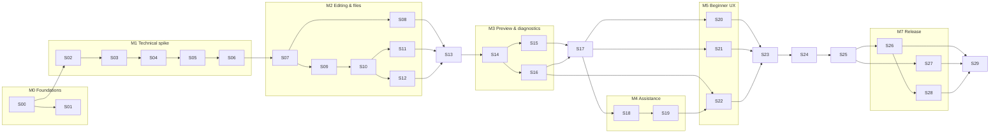

# NoobIDE roadmap

How [PLAN.md](../PLAN.md) gets built across many short sessions. PLAN.md is the product source of truth; this file
is the build order. The machine-readable backlog is [harness/features.json](../harness/features.json) — use
`npm run session -- next` to see what is ready.

## Structure

```
Milestone (M0–M8)      = a PLAN §10 phase, ends with a gate review
  └─ Session (S00–S29) = one sitting of agent work (~2–5 h), one coherent goal, leaves verify green
       └─ Feature (S07.2) = one verifiable unit with acceptance criteria and a verify kind
Owner tasks (H.1–H.8)  = things only you can do: accounts, devices, user studies, go/no-go calls
```

- **30 sessions, 129 agent features, 8 owner tasks.** PLAN estimates ~600 h of solo engineering for the MVP; with an
  agent doing most of the typing, the bottleneck becomes your review time, owner tasks and real-device checks.
- **Sessions are sized, not scheduled.** Do one per sitting. If a session runs long, stop at a feature boundary;
  the next session continues it (`next` keeps showing its unfinished features).
- **Parallel lanes** exist where the graph allows (e.g. S01 ∥ S02, S08 ∥ S09, S15 ∥ S16, S20 ∥ S21 ∥ S18). Run them
  in separate git branches/worktrees and merge one at a time.
- **Gates** (G1, G2, G3, G7) are review sessions that write `docs/reviews/Gx.md` with evidence per platform and a
  re-estimate. PLAN §10: "finished UI screenshots are not proof that a feature is complete."

## Dependency graph



## Milestones and sessions

### M0 — Foundations & scope (PLAN week 1)

| Session | Title                           | Goal                                                                                          | After | Feat. |
| ------- | ------------------------------- | --------------------------------------------------------------------------------------------- | ----- | ----- |
| S00     | Harness & toolchain             | Harness, toolchain, roadmap; verify green. **Done in session 0.**                             | —     | 2     |
| S01     | Scope, task script & wireframes | One-page scope, 10-minute task script, three wireframes (welcome, editor+preview, error card) | S00   | 4     |

Owner: H.1 min OS versions + Apple Silicon device, H.2 Apple Developer + Windows signing, H.3 3–5 beginner
walkthroughs of the wireframes, H.4 confirm assumptions (Chinese-first UI, hours/week, no Windows arm64 in v1).

### M1 — Technical validation spike (PLAN weeks 2–3) → Gate G1

The riskiest assumptions first: packaged Electron on both platforms, Chinese paths, preview isolation, infinite loops.

| Session | Title                                  | Goal                                                                                        | After | Feat. |
| ------- | -------------------------------------- | ------------------------------------------------------------------------------------------- | ----- | ----- |
| S02     | Electron + React + Monaco scaffold     | Secure-by-default app, React shell, offline Monaco, i18n, e2e smoke, Windows installer      | S00   | 7     |
| S03     | Restricted IPC + open/save a real file | Typed validated IPC; platform adapters; save in `中文 路径` path                            | S02   | 4     |
| S04     | Static server + isolated preview       | Loopback server with path guard; sandboxed WebContentsView; edit→save→refresh               | S03   | 4     |
| S05     | Isolation & baseline                   | `while(true)` and log floods can't hurt the editor; diagnostic capture spike; perf baseline | S04   | 6     |
| S06     | CI matrix & Gate G1                    | GitHub Actions win-x64 + mac-arm64; arch inspection; physical Mac run; re-estimate          | S05   | 4     |

**G1 exit:** templates open on both platforms · native arm64 on Mac · Chinese paths work · editor responsive during
infinite loop · out-of-project reads rejected · re-estimate written. If preview isolation fails here, fix it before
anything else (PLAN §8, §13).

### M2 — Editing & file foundations (PLAN weeks 4–7) → Gate G2

| Session | Title                                   | Goal                                                                | After         | Feat. |
| ------- | --------------------------------------- | ------------------------------------------------------------------- | ------------- | ----- |
| S07     | Workspace core                          | Paths, lazy tree, watcher, encodings/EOL                            | S06           | 4     |
| S08     | File tree UI & operations               | Accessible tree; create/rename/trash; never silently overwrite      | S07           | 5     |
| S09     | Tabs & model management                 | One model per URI; state survives switching; IME checks             | S07           | 5     |
| S10     | Save pipeline                           | Atomic writes, autosave state machine, failure scenarios keep edits | S09           | 5     |
| S11     | External change conflicts               | Detect, diff, choose — never silent                                 | S10           | 3     |
| S12     | Crash recovery journal                  | ≤2 s journal; restore after forced kill on both platforms           | S10           | 4     |
| S13     | Settings, recents, session restore & G2 | Versioned settings, `.noobide/project.json`, restore, logs, G2      | S08, S11, S12 | 7     |

**G2 exit:** content recovers after forced termination on both platforms · failed saves preserve edits · projects
transfer correctly between platforms.

### M3 — Preview & diagnostics (PLAN weeks 8–10) → Gate G3 (invite-only build)

| Session | Title                        | Goal                                                                  | After    | Feat. |
| ------- | ---------------------------- | --------------------------------------------------------------------- | -------- | ----- |
| S14     | Preview manager              | State machine, auto/manual refresh, entry page, trust, partitions     | S13      | 6     |
| S15     | Preview UI & layout          | Splitters, narrow Code/Preview switch, viewport width, DPI/focus sync | S14      | 6     |
| S16     | Diagnostics pipeline         | ProblemRecord, runtime capture, refresh attribution, rate limits      | S14      | 6     |
| S17     | Problems & console panel, G3 | Non-intrusive problems panel, go-to-code, console, G3                 | S15, S16 | 4     |

### M4 — Editing assistance (PLAN weeks 11–12)

| Session | Title              | Goal                                                       | After | Feat. |
| ------- | ------------------ | ---------------------------------------------------------- | ----- | ----- |
| S18     | Language features  | Completion/hover/format validated offline; worker recovery | S17   | 4     |
| S19     | Static diagnostics | Markers → Problems, tuned for beginners                    | S18   | 2     |

### M5 — Beginner experience (PLAN weeks 13–14)

| Session | Title                   | Goal                                                      | After         | Feat. |
| ------- | ----------------------- | --------------------------------------------------------- | ------------- | ----- |
| S20     | Templates & welcome     | Three templates, welcome + create wizard, file role hints | S17           | 3     |
| S21     | Local history           | Snapshot store, triggers, diff + restore UI               | S17           | 4     |
| S22     | Error explanation rules | Rules engine + 15 rules + problem card                    | S16, S19      | 4     |
| S23     | Onboarding walkthrough  | The PLAN §2 journey inside a real project + unguided task | S20, S21, S22 | 4     |

Owner: H.6 five-beginner study on both platforms → fixes feed back into M5/M6.

### M6 — Platform integration (PLAN weeks 15–16)

| Session | Title                            | Goal                                                      | After | Feat. |
| ------- | -------------------------------- | --------------------------------------------------------- | ----- | ----- |
| S24     | Commands, shortcuts, menus, a11y | One command registry → menus/shortcuts; a11y pass; themes | S23   | 4     |
| S25     | Platform hardening               | Sleep/wake, permission errors, preview permission denials | S24   | 4     |

### M7 — MVP validation & release pipeline (PLAN weeks 17–20) → Gate G7

| Session | Title                 | Goal                                                          | After         | Feat. |
| ------- | --------------------- | ------------------------------------------------------------- | ------------- | ----- |
| S26     | Fault-injection suite | Every PLAN §11 failure case → test or checklist, on both OSes | S25           | 2     |
| S27     | Performance & offline | p95 startup, save→preview, memory; offline acceptance         | S25           | 3     |
| S28     | Distribution pipeline | Makers, signing/notarisation, upgrade/uninstall, user docs    | S26           | 6     |
| S29     | Release acceptance    | Full §11 checklist on clean Win x64 + physical Apple Silicon  | S26, S27, S28 | 3     |

### M8 — Beta hardening (PLAN weeks 21–28)

Owner-led: H.7 beta with 8–12 new beginners, H.8 public-beta go/no-go. Agent sessions are added as features
(S30+) from beta findings.

## Rules for changing the plan

- Scope changes go through PLAN.md (owner) and a decision record in `docs/decisions/`.
- New work = new feature IDs. Features are never deleted and acceptance criteria never weakened; replace a feature
  with `set <id> superseded --by <new id>`. `npm run verify` enforces this against the last commit.
- At the start of each milestone, the first session may **refine** that milestone's features (split, add criteria)
  based on what earlier gates learned.
- If the schedule slips, defer first: extra templates, viewport presets, cross-file navigation. Protect editing,
  preview, saving, error locations and recovery (PLAN §10).

## Assumptions carried from PLAN (owner to confirm — H.4)

- Chinese-first UI with English available; ~30 productive hours/week; prior React/TypeScript experience.
- macOS arm64 + Windows x64 at launch; Windows arm64, Intel Mac and Linux later.
- The development machine is Windows; a physical Apple Silicon Mac is needed for `manual-mac` features and gates.
- Toolchain versions pinned in session 0 (TypeScript 6.0, Vitest 5, ESLint 10). Electron, Forge, React and Monaco
  versions are chosen and pinned in S02 (latest stable on 2026-10-14: Electron 44.7, Forge 8.0, React 19.3,
  Monaco 0.57). TypeScript 7 is out but typescript-eslint does not support it yet.
